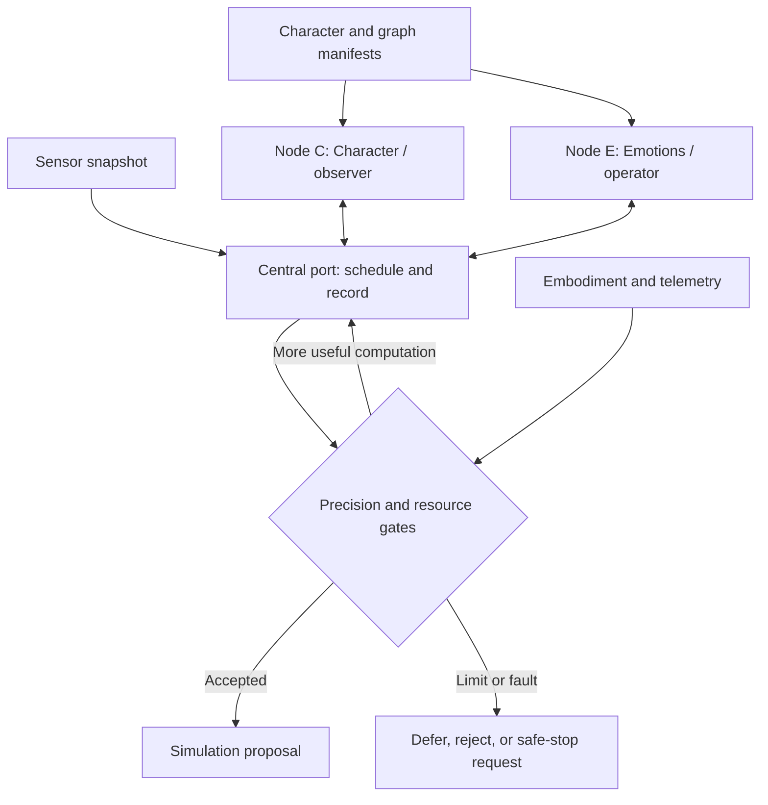

# 2-Node Neural Pulse

**A two-pole recurrent architecture for a resource-aware observer–operator.**

Neural Pulse formalizes Nikita Beregovykh's sketch: **Character ↔ central Port ↔ Emotions**. Sensor events activate graphs; two state vectors exchange updates through the port; temporary memory records the exchange until a numerical criterion or a resource limit ends the pulse. An embodiment manifest declares shape, sensors, and accessible manipulators.

**v0.1.0 is a runnable classical simulation and architecture specification.** It has hand-authored recurrent weights, no training pipeline, no physical actuator driver, and no implemented QPU backend. “Two nodes” means two computational modules, each containing a vector of units—not two biological neurons or two qubits.



The observer/operator assignment is a proposed interpretation of the sketch. Both poles participate in observation and action selection. The central port is control infrastructure, not a third learned pole.

## Run it

Python 3.10+; no third-party runtime dependencies. Run these commands from the repository root:

```bash
python -m neural_pulse validate
python -m neural_pulse demo
python -m neural_pulse demo --scenario hazard
python -m neural_pulse demo --scenario low-energy
python -m unittest discover -s tests -v
```

For a machine-readable trace:

```bash
python -m neural_pulse demo --output pulse-result.json
```

The example runs against a deterministic **virtual clock**. It does not measure hardware latency or energy. The normal result, including the graph output sequence and temporary state history, is checked in at [examples/normal-result.json](examples/normal-result.json).

## The structure

| Sketch element | Repository representation |
|---|---|
| Character, authored by an artist | [character.json](examples/character.json): named axes and baseline values |
| Emotions matrix: `[n]` graphs | [emotions.json](examples/emotions.json): triggers, directed edges, parameters |
| Parameter `[a]` | Node's authored signed intensity in `[-1, 1]` |
| Sequence number `[b]` | Unique zero-based output slot, preserved even when its graph is inactive |
| Two vectors swinging through the port | Character state `u` and emotion state `v`, updated alternately |
| Body and accessible manipulators | [embodiment.json](examples/embodiment.json): category, geometry metadata, sensors and capabilities |
| Power, reserve, overload and stopping | [controller.json](examples/controller.json): engineering-owned limits |
| Temporary memory | Bounded per-pulse ring buffer of state updates |
| Processor choice | Classical reference implementation; explicitly reserved asynchronous QPU interface |

## Read the specification

- [Concept and interpretation decisions](docs/CONCEPT.md)
- [Equations, stopping conditions and energy accounting](docs/ARCHITECTURE.md)
- [Artist's manifest guide](docs/AUTHORING.md)
- [Embodiment, real-time and QPU integration boundaries](docs/INTEGRATION.md)
- [Research sources and evidence limits](docs/RESEARCH.md)
- [Validation and next implementation gates](docs/VALIDATION.md)
- [JSON Schema contracts](schemas/)

## What “infinite processing” means here

Reusing two recurrent modules permits an arbitrary number of *potential* refinement steps without adding new modules. Every actual request has finite time, energy, memory, and numerical resolution. A stable internal state also does not establish that a conclusion is correct about the world.

The reference recurrence has a contraction bound for a fixed sensor snapshot. The port stops after the numerical state-error bound stays below the configured tolerance, or it returns an explicit terminal reason. Sensor uncertainty is a separate gate. See [the mathematical distinction](docs/ARCHITECTURE.md#precision-and-convergence).

## Status

Implemented: manifest validation, triggered graph evaluation, alternating recurrent updates, deterministic output ordering, bounded memory, conservative energy ledger, deadline/freshness checks, mid-pulse telemetry checks, and failure-path tests.

Specified for future work: trained models, calibrated task confidence, hard real-time scheduling, physical geometry checking, actuator acknowledgements, organic interfaces, and quantum jobs. No current vendor compatibility or quantum advantage is claimed. The existing [MIT license](LICENSE) is retained.
