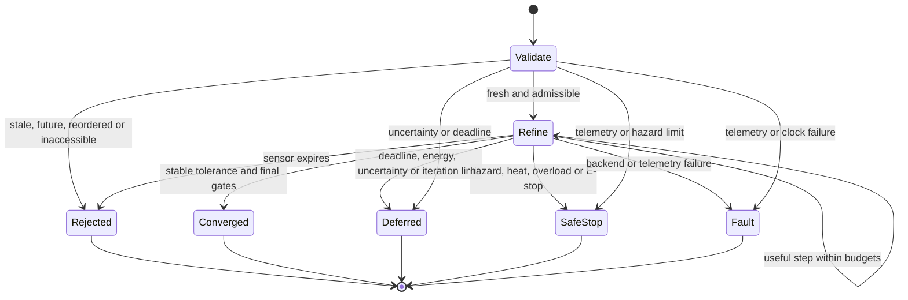

# Architecture and reference mathematics

## Boundaries

The library consumes a validated configuration bundle, one sensor snapshot, and telemetry. It returns a simulation proposal or an explicit terminal outcome. No network, device bus, biological interface, background thread, or cloud job is started.

For one request, the artist data, sensor snapshot and graph modulation stay fixed. Only telemetry is refreshed during refinement. A production event ingress must cancel/supersede a stale request when a newer observation changes the task; this prototype is synchronous and checks age rather than implementing that queue.

## Symbols

| Symbol | Meaning |
|---|---|
| `d` | Number of character axes |
| `s` | Number of declared sensors |
| `n` | Number of emotion graphs |
| `u_k, v_k ∈ [-1,1]^d` | Character and emotion state vectors after swing k |
| `c ∈ [-1,1]^d` | Authored character bias |
| `z ∈ [-1,1]^s` | Normalized sensor snapshot |
| `W ∈ R^(d×s)` | Engineering-owned sensor-to-axis mapping |
| `m ∈ [-1,1]^d` | Triggered graph modulation |
| `α, β ∈ [0.05,1]` | Character and emotion update rates |
| `ρc, ρe ∈ [-0.9,0.9]` | Cross-pole scalar couplings |

The executable example has `d=3`, `s=3`, `n=2`. These sizes are illustrative. Limits cap axes at 32 and total graph vertices at 256 in this version.

## Graphs and output sequence

For graph i, define a directed graph `G_i = (V_i, E_i, a_i, b_i, trigger_i)`.

For each vertex j, `a_ij` is an authored intensity; `b_ij` is its global output position. Trigger activation is:

```math
g_i = \mathbf{1}[z_{sensor(i)} \ge threshold_i]
```

One synchronous propagation uses source **base values**, not partially updated destinations:

```math
h_{ij}=\operatorname{clip}_{[-1,1]}
\left(g_i a_{ij}+\sum_{\ell\to j} w_{i\ell j}\,g_i a_{i\ell}\right)
```

Incoming absolute edge weights per destination sum to at most one. Self-loops and cycles remain finite because this is a single propagation pass. Recurrent exchange happens between C and E, not by recursively walking graph edges.

The serialized sequence is `o[b_ij] = h_ij`. Inactive graphs keep their slots and emit zero. Distinct vertices can map to the same axis; their values are summed and clipped to form `m`. This can saturate and lose distinctions; the full output sequence remains available for inspection. `b` specifies serialization position, not a time delay, actuator priority, repetition count, or output probability. A future time-based sequence needs a separate schedule contract.

## Alternating updates

```math
u_{k+1}=(1-\alpha)u_k+\alpha\tanh(c+Wz+\rho_c v_k)
```

```math
v_{k+1}=(1-\beta)v_k+\beta\tanh(m+\rho_e u_{k+1})
```

The same parameters are reused every swing. This is a small nonlinear recurrent network with fixed, authored weights. It has no trained perception model and no learned world dynamics. Future learned modules must preserve the input/output contract and provide their own convergence and timing evidence.

The initial pulse starts with zeros. A `CONVERGED` pulse commits its final state as the next pulse's warm start. Deferred, rejected, stopped, or faulted pulses do not overwrite that pair. The manifest is copied and hashed when the port is constructed; changing caller-owned dictionaries cannot change a running port.

## Precision and convergence

Since tanh is 1-Lipschitz, the reference map has an infinity-norm contraction factor bounded by:

```math
q_C=1-\alpha+\alpha|\rho_c|,\qquad
q=\max\{q_C,\,1-\beta+\beta|\rho_e|q_C\}<1.
```

For fixed inputs and the reference map, this supplies a unique fixed point in exact arithmetic. With `x_k=(u_k,v_k)` and `Δ_k=||x_k-x_(k-1)||∞`, the post-update state error satisfies:

```math
\|x_k-x^*\|_\infty\le\frac{q}{1-q}\Delta_k.
```

The implementation requires this bound to remain below `state_error_tolerance` for `stable_iterations` consecutive swings. Floating-point roundoff is not included in that analytical bound; values near machine precision need additional numerical analysis. Tests compare the coarse bound with a much tighter reference solution.

This is **state precision**, not task precision. Repeating an incorrect model can converge confidently to an incorrect action. The scalar sensor `uncertainty` is supplied by the caller and separately gated; it is neither calibrated by this library nor inferred from the iteration count. Real task acceptance needs independently calibrated perception, prediction error, and task-success criteria.

For injected test backends the bound is `null`, and no proposal is authorized. General neural networks may oscillate, diverge, or stall; contraction of this reference map cannot be transferred to them without evidence.

## Central port lifecycle



Malformed manifests and frames raise `ContractError` before computation. Recognized operational failures return an `Outcome`; they are not silently treated as success. Only `CONVERGED` has a proposal. `SAFE_STOP` is a **request to a future independent supervisor**, not evidence that hardware has stopped.

Frames use a strictly increasing sequence and nondecreasing timestamp within one port session. Timestamps must use the same monotonic clock domain as the port, not UTC wall time. Future and stale frames are rejected. Rejected freshness checks do not advance the accepted sequence. A timestamp can stay equal when multiple samples share clock resolution. Accepted requests that later fail are consumed and require a newer sequence for retry.

## Energy and useful computation

Before every swing, the port requires:

```math
E_{available}\ge E_{reserve}+E_{fallback}+E_{action}+E_{swing}.
```

`E_swing` is debited before computation, including a failed backend call. The final action allocation is debited once on acceptance, with another telemetry check immediately before proposal creation. On any other outcome, a fallback allocation up to the remaining energy is debited. Action and fallback allocations are simulation accounting, not observed expenditure.

Across pulses, the available energy is the lesser of the internal ledger and the new telemetry estimate. A higher reading does not automatically recharge the ledger. Charging/reconciliation must be explicit in a future supervisor. If the incoming battery is already below its reserve, the controller cannot restore that reserve; it requests a safe stop and never emits a normal proposal.

`compute_j_per_swing`, `action_j`, `fallback_j`, overload risk and temperature limits are example configuration values. They are **not measured or qualified device ratings**. The prototype does not meter setup, graph evaluation, callbacks, sensor processing, cooling, or low-level actuation. Deployment must replace this with measured upper bounds and include all those costs.

Refinement also tracks `(previous_error-current_error)/E_swing`. If this falls at or below `min_improvement_per_j` for `stall_iterations`, it defers. This is a numerical progress heuristic, not a proven estimate of expected task utility. The default threshold is zero. A future decision model should compare expected task benefit against compute, actuation, and reserve costs.

## Memory and output

The ring buffer holds at most `memory_capacity` recent updates, clears for each new pulse, and records state vectors, residual, error bound and energy. Total iterations and final reason remain available even when earlier updates have been evicted. No claim of a complete trace is made when the ring is smaller than the iteration count.

The reference decoder produces one nonnegative scalar virtual velocity:

```math
speed=v_{max}\operatorname{clip}_{[0,1]}
\left(0.5+\sum_j w_j^{action}(u_j+v_j)/2\right).
```

This deliberately simple, hand-authored decoder demonstrates the data path; it is not a robot policy. A proposal carries the source sequence, target, coordinate frame and expiry. It never commands a device. Manipulator accessibility and speed bounds are checked; collision, reachability, force and joint limits are not implemented.
